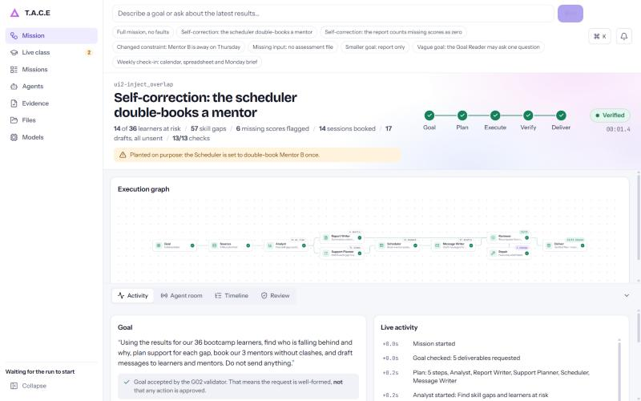
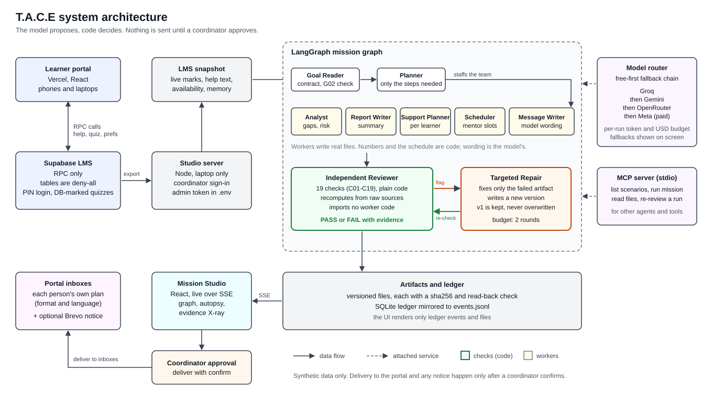
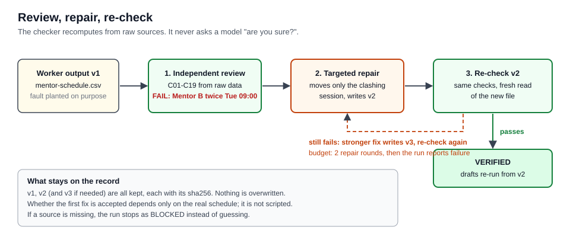
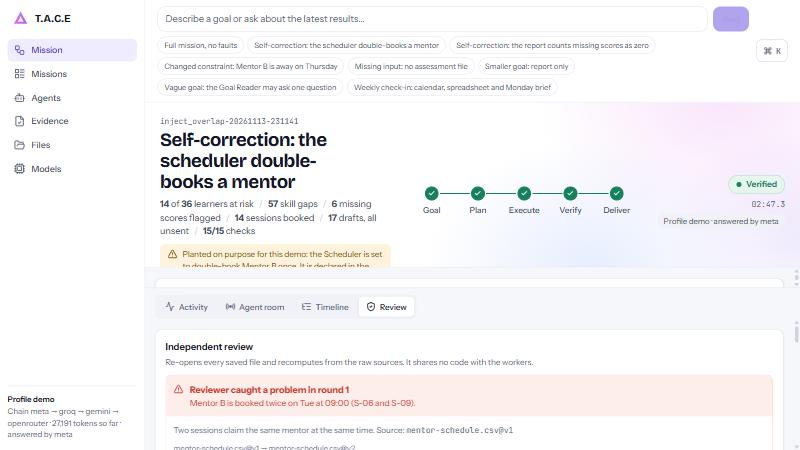
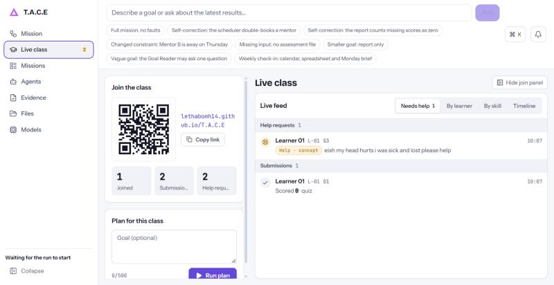
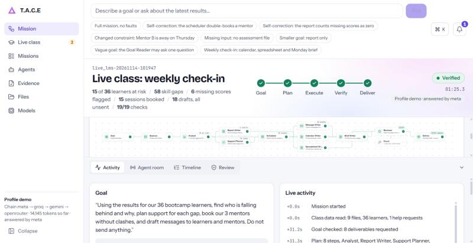

<div align="center">

# T.A.C.E

**An AI colleague for education coordinators: give it one goal, it plans the work, writes real files, has an independent checker catch its mistakes, fixes them, and waits for your approval before anything reaches a learner.**

[](https://github.com/LethaboMH14/T.A.C.E/actions/workflows/runtime.yml)




</div>

> Synthetic data only: 36 learners, 3 mentors. No real learner records are used anywhere in this repository.

## Live links

| | |
|---|---|
| Learner portal (open on your phone) | https://lethabomh14.github.io/T.A.C.E/ |
| Demo recording (Loom) | https://www.loom.com/share/64b892caa03446e0852f329a569231ce |
| Coordinator Studio (live during the demo, sign-in required) | https://nova-depends-souls-palestinian.trycloudflare.com |
| Source | https://github.com/LethaboMH14/T.A.C.E (branch `feat/mission-engine`) |
| CI | [runtime workflow](https://github.com/LethaboMH14/T.A.C.E/actions/workflows/runtime.yml) |

Mission Studio runs on the presenter's laptop (`npm run studio`). During the demo it is published through a Cloudflare tunnel with coordinator sign-in; that link works only while the laptop is on.

## What it does

- **One goal in, a plan out.** A coordinator types a sentence. The Goal Reader turns it into a checked contract (and asks one multiple-choice question only if the goal is genuinely unclear). The Planner builds a task graph with only the steps that goal needs: a smaller goal gets a smaller team.
- **Real work, real files.** Analyst, Report Writer, Support Planner, Scheduler and Message Writer write versioned files (gap analysis, performance summary, improvement plans, mentor schedule, message drafts), each with a sha256 and a read-back check.
- **An independent Reviewer catches mistakes.** It is plain code that imports no worker code and recomputes everything from the raw sources (19 checks, C01 to C19). It does not ask a model "are you sure?".
- **Targeted repair, then re-check.** Repair changes only what failed and writes a new version. The old version is kept. The Reviewer re-checks from scratch. If a source is missing the run stops as BLOCKED instead of guessing.
- **Nothing is sent without a person.** The coordinator approves, then each learner and mentor gets their own plan in a phone portal inbox, in their chosen format and language. An optional email or SMS notice goes only to people who opted in.

## How it is built

<p align="center"></p>

### Self-correction loop

<p align="center"></p>

The faults in the demo scenarios are **planted on purpose**. They are declared in the scenario file, in the ledger (`plantedFault`) and on screen. The catching and the fixing are not scripted: whether the Reviewer accepts the first repair depends only on the real schedule.

## Screens

| | |
|---|---|
|  |  |
| **Review.** The Reviewer re-opens the saved schedule, finds Mentor B booked twice, and the repair is re-checked from scratch. | **Live class.** Join QR, live counts, and learners' help requests grouped by need. |
|  | |
| **Run on live class data.** 36 learners from the portal, 19 of 19 checks passed, ready for the coordinator to approve. | Learner portal: open https://lethabomh14.github.io/T.A.C.E/ on a phone or laptop. |

## Run it in 2 minutes

Needs Node 22.13 or newer. No key is needed for the code-only run.

```sh
npm ci                                        # locked dependencies
npm test                                      # unit, E2E and G01/G02 gate tests
npm run demo:inject_overlap                   # a real mission, code only: plants a double-booking, catches it, repairs, re-checks
node cli/tace.mjs list                        # the other scenarios

cp .env.example .env                          # then add one or more model keys (see docs/MODEL-PROVIDERS.md)
npm run providers                             # checks each configured provider; keys are never printed
MODEL_PROFILE=free npm run demo:inject_overlap  # same mission with model agents on free models

(cd apps/studio && npm ci && npm run build)   # build the React Mission Studio once
npm run studio                                # Mission Studio at http://localhost:4173 (classic page at /classic)
npm run mcp                                   # T.A.C.E as an MCP server (see mcp/README.md)
```

Other scenarios: `npm run demo:baseline`, `demo:report_only`, `demo:inject_wrong_aggregate`, `demo:mentor_unavailable`, `demo:missing_source`.
`npm run fixtures` regenerates and validates the synthetic cohort.

## Live class: learners on their phones

This is the setup used for the Saturday demo. The goal: people in the room scan a QR code, use the portal, and the coordinator's Studio sees them live.

1. **Supabase (LMS backend).** The portal talks to one Supabase project through RPC functions only; the tables are deny-all. The repo ships the seed generator (`node tools/lms/seed-sql.mjs > seed.sql`) and an end-to-end smoke test (`node tools/lms/smoke.mjs`). The SQL that defines the tables and RPC functions is **not in this repository**, so a fresh Supabase project cannot be rebuilt from the repo alone (see Limitations). The RPC contract is in [apps/lms/LMS-SPEC.md](apps/lms/LMS-SPEC.md).
2. **Admin token for this laptop.** `node tools/lms/admin-token.mjs <https://ref.supabase.co> <publishable-key>` writes `LMS_ADMIN_TOKEN`, `LMS_URL` and `LMS_PUBLISHABLE_KEY` into the git-ignored `.env` and prints only the token's sha256.
3. **Portal (Vercel).** `apps/lms` is a Vite app (`vercel.json` included). Build with `cd apps/lms && npm ci && npm run build`. It reads `VITE_LMS_URL` and `VITE_LMS_KEY` and falls back to the team's project. Put the portal address in a QR code.
4. **Coordinator account.** Create the Studio sign-in once, on the laptop: `node tools/lms/staff.mjs --email you@example.com --name "Coordinator"`. The password is typed twice, hidden, and never printed. The Studio then requires this sign-in for every `/api` route (`STUDIO_LOGIN=off` turns it off for local development).
5. **Notifications (optional, off by default).** Set `BREVO_API_KEY`, `NOTIFY_FROM_EMAIL` and `PORTAL_URL` in `.env` to send a fixed "you have a new plan in your portal" notice to opted-in people after approval. No plan content is in the message. Details and privacy rules: [docs/NOTIFICATIONS.md](docs/NOTIFICATIONS.md). Without a key nothing is sent.
6. **Before the room fills.** Run `npm run studio`, sign in, and check `GET /api/lms/status`. `lms_admin_reset` returns the demo to the seeded baseline.

## Measured results

Only numbers that appear in the repository's own files. Every run is on the synthetic cohort (36 learners, 3 mentors).

| What | Result | Source |
|---|---|---|
| `inject_overlap` with Meta `muse-spark-1.3` agents | Goal contract passed the G02 validator first time. Reviewer found Mentor B booked twice Tue 09:00, Repair moved 1 session (v1 kept), drafts re-written from v2, 14 of 14 checks passed. VERIFIED in 52 s, 5 model calls, 11,789 tokens. | run log of 13 Nov 2026 (kept under "Earlier measured runs" below) |
| `inject_overlap` on free models (`MODEL_PROFILE=free`) | VERIFIED in 56 s at $0, with live fallbacks Groq 429 to Gemini and Gemini 503 to OpenRouter. | same log |
| `inject_wrong_aggregate`, code only | Reviewer recomputed 64.5 against the planted 60.9; Repair wrote v2 byte-identical to the correct file. | same log |
| `missing_source` | BLOCKED, nothing guessed, nothing produced. | same log |
| LMS load test, capped at 24 requests in flight, 150 synthetic users | 146 of 150 accounts created, 144 of 150 completed the full flow including sign-out and back in; claim race, unique ids and clean reset passed. About 22 calls per second from one laptop. | [docs/LOAD-TEST.md](docs/LOAD-TEST.md), "Re-runs on 14 Nov 2026" |
| LMS load test, first pass at 100 and 150 users | **Failed**: profile ids past 99 collided (a padding bug) and p95 latency was over the 1000 ms budget. Fixed in the live database; see the re-runs above. | [docs/LOAD-TEST.md](docs/LOAD-TEST.md) |

Not measured: 150 real phones on venue Wi-Fi, Vercel hosting under load, any effect on coordinator time or learner outcomes.

## How this maps to the judging criteria

| Criterion | See it in the app | Code and tests |
|---|---|---|
| Reasoning and planning | Type a goal in Mission Studio; the graph builds. Ask for just a report and the team shrinks. | `engine/planner.mjs`, `engine/graph.mjs`, `agents/goal-reader.mjs`; `tests/unit/planner.test.mjs`, `tests/unit/graph.test.mjs` |
| Self-correction | Failure Autopsy tab: red check, repair diff, green re-check, v1 and v2 files side by side. | `domains/education/reviewer.mjs`, `domains/education/repair.mjs`; `tests/unit/reviewer.test.mjs`, `tests/e2e/mission.test.mjs` |
| Execution and reliability | Files view: real outputs with sha256; `missing_source` ends BLOCKED. Provider fallbacks are shown. | `engine/artifacts.mjs`, `engine/providers.mjs`; `tests/unit/artifacts.test.mjs`, `tests/unit/providers.test.mjs` |
| Multi-agent collaboration | Agent room: typed hand-offs; node inspector: inputs, outputs, model and tokens per agent. | `engine/messages.mjs`, `agents/*.mjs`; `tests/unit/messages.test.mjs`, `tests/unit/agents.test.mjs` |
| EdTech impact | Live class feed, then each learner's own plan in their portal inbox, in their format and language. | `domains/education/`, `apps/lms`; `tests/e2e/personalisation.test.mjs`, `tests/unit/lms-snapshot.test.mjs` |
| Presentation and Q&A | The live demo flow is goal, plan, fail, fix, verify, approve, deliver (the script is kept outside this repository). | n/a |
| Professionalism | CI on every push; honest limits below; consent-gated notices. | `.github/workflows/runtime.yml`, [docs/NOTIFICATIONS.md](docs/NOTIFICATIONS.md) |

## Limitations (read before trusting it)

- **Synthetic data only.** No real learner data, no consent process, and no claim of POPIA compliance. Impact on coordinators' time and on learner outcomes is **not measured**.
- **Planted faults.** The double-booking and the wrong aggregate are inserted on purpose to test the Reviewer. The scenario file, the ledger and the screen say so.
- **Models draft, code decides.** Numbers, the schedule and the checks are code. Models draft the goal contract, propose the team, write message wording and explain verdicts; each is checked by code before use. Model quality varies by provider; Meta's structured output rejects regex `pattern`, so the adapter strips it and code re-validates.
- **Delivery is real but gated.** After coordinator approval, plans are written to portal inboxes. Email and SMS notices are off until a Brevo key is set, and have **never been sent to a real inbox or phone** (every test uses a fake fetch).
- **Portal login is a 4 to 8 digit PIN with no lockout.** Acceptable for synthetic data, not for real learners.
- **Backend not reproducible from the repo.** The Supabase table and RPC SQL is not committed; only the seed generator and the contract are.
- **Load.** Tested from one laptop; the 150-user result used a request cap. Real phones, venue Wi-Fi and Vercel were not tested. The Supabase project is on a free tier.
- **Pacing.** Mission Studio paces runs to about 0.65 s per step so people can follow them; the times in the table are real run times, not paced.
- **No multi-tenant layer.** One coordinator account on one laptop.
- The test count and CI status change with the branch; check the badge above rather than a number in this file.

## Privacy and safety

- Nicknames only; the portal says "Don't use your real full name. Demo data only."
- Contact details are stored only if a person ticks an unticked consent box; removing them stores nothing.
- The portal's database tables are deny-all; the browser can only call named RPC functions with a session token. Studio admin functions need a token that lives only in the laptop's `.env`.
- Keys are read from the environment, never logged, and removed from error text. `MODEL_RUN_MAX_TOKENS` and `MODEL_RUN_MAX_USD` cap each run; `MODEL_RUN_MAX_USD=0` is a kill switch.
- Meta's contributor mode (cheaper, may be used for training) is off by default and must only be used with synthetic data.
- The message drafts are marked UNSENT until a coordinator confirms delivery.

---

## Technical detail

<details>
<summary>Components</summary>

- **Engine (`engine/`, domain-neutral):** source admission with sha256 and row numbers; planner (only the steps the deliverables need); LangGraph mission graph; artifact store with read-back verification; SQLite ledger mirrored to `events.jsonl`; model adapter and provider router (`engine/providers.mjs`: demo, free, cheap profiles, visible fallbacks, per-run token and USD budget); typed agent messages (zod); LMS client (`engine/lms.mjs`); notices (`engine/notify.mjs`).
- **Agents (`agents/`):** Goal Reader (model to G02 contract; the validator decides), Supervisor (model staffs the team; the planner decides), Reviewer voice (plain verdicts; the code route decides), question gate.
- **Education pack (`domains/education/`):** analyst, support planner, scheduler, writer (code); model Message Writer (facts copied by code, wording by the model); independent Reviewer with 19 checks C01 to C19; targeted Repair with a propose-and-verify ladder and a budget of 2 rounds; LMS snapshot into the engine's sources.
- **Studio (`apps/studio`):** React, React Flow, Radix-style components, Motion. It renders only ledger events and files: graph, Failure Autopsy, Evidence X-Ray, Agent room, model use, versioned files. Server: `web/server.mjs` with route modules in `web/api/`.
- **Portal (`apps/lms`):** React, mobile first, voice input and read-aloud where the phone supports them.
- **MCP (`mcp/server.mjs`):** list scenarios, run a mission, read files, re-review a run.
- **Specs:** [agents](engine/AGENTS-SPEC.md), [portal](apps/lms/LMS-SPEC.md), [Studio workspace](apps/studio/WORKSPACE-SPEC.md), [model providers](docs/MODEL-PROVIDERS.md), [notifications](docs/NOTIFICATIONS.md), [load test](docs/LOAD-TEST.md), [ADR-0008](docs/decisions/ADR-0008-runtime-slice.md), reviews: [wave 1](docs/reviews/WAVE1-REVIEW-20261113.md), [wave 2](docs/reviews/WAVE2-REVIEW-20261113.md).
- **Editable diagrams:** [diagrams.net source](diagrams/TACE-Architecture.drawio), [Mermaid execution flow](diagrams/TACE-EXECUTION-END-TO-END.mmd), [run state machine](diagrams/TACE-RUN-LIFECYCLE.mmd), [system diagram notes](docs/architecture/ARCHITECTURE-DIAGRAM.md).

</details>

<details>
<summary>Earlier measured runs (13 Nov 2026, run log carried over from the previous README)</summary>

| Run | What happened | Result |
|---|---|---|
| `inject_overlap`, Meta `muse-spark-1.3` agents | The Goal Reader's contract passed G02 first time. The Supervisor's team matched the planner. Code found 57 gaps and 14 learners at risk and booked 14 sessions; the model wrote 17 drafts. **Reviewer: Mentor B booked twice Tue 09:00**, Repair moved 1 session (v1 kept), the model re-wrote drafts from v2, 14/14 checks | **VERIFIED in 52 s**, 5 model calls, 11,789 tokens |
| `inject_overlap`, `MODEL_PROFILE=free` | Same story on Groq `gpt-oss-20b`. Live fallbacks: Groq rate limit (429) to Gemini; Gemini 503 to OpenRouter free | **VERIFIED in 56 s, $0** |
| `inject_wrong_aggregate` (code only) | Planted: S3 mean counts missing scores as zero (60.9). Reviewer recomputes 64.5, Repair writes v2, byte-identical to the correct file | VERIFIED after 1 repair |
| `report_only` | Smaller goal, planner picks 2 steps instead of 5 | VERIFIED |
| `mentor_unavailable` | Mentor B away Thursday, re-planned, 14 booked | VERIFIED |
| `missing_source` | No assessment file, nothing guessed, nothing produced | BLOCKED (honest) |
| Agent E2E (scripted model double) | The model writes 11:30 for a 09:00 session, check **C14** catches it, the writer is re-run with the checker's feedback, passes | VERIFIED |

The run folders under `runs/` are local and git-ignored, so these figures come from this log, not from committed files. The test count in the previous README (473) was not re-verified for this revision.

</details>

<details>
<summary>Project design record: gates, ADRs and handover (dated; may lag the code)</summary>

The sections below are the original design record. They are dated, and where they differ from the running code (for example, they describe sending and auth as not built, and PR #8 as unmerged), trust the code and the sections above.

## Claude Code / engineering handover — START HERE

The complete, navigable project architecture, existing research, decisions, technical execution contracts, security boundaries, UI stack, and prioritized implementation backlog are now documented **inside this repository**. **No new runtime capability is claimed by adding these documents.**

- **[CLAUDE.md](CLAUDE.md)** — required starting point for Claude: what is approved, what runs, current PR #8, engineering rules and the build mission.
- **[AGENTS.md](AGENTS.md)** — repository-wide, tool-neutral contributor conventions and security/approval limits.
- **[START-HERE](docs/handover/START-HERE.md)** — dated factual status and entry points to verified source and proposed work.
- **[Complete system blueprint](docs/architecture/COMPLETE-SYSTEM-BLUEPRINT.md)** — G01–G12, full goal→plan→agents→tools→checks→repair→delivery lifecycle.
- **[Contracts, state machine and API](docs/architecture/CONTRACTS-STATE-MACHINE-AND-APIS.md)** — versioned schemas, endpoints, typed events, exact approval and receipts (future runtime design).
- **[Security, tools, skills and memory](docs/architecture/SECURITY-MEMORY-AND-TOOL-BOUNDARIES.md)** — all 20 G01 risk controls, source and tool policies, POPIA and governance.
- **[Mission Console UI/UX](docs/architecture/MISSION-CONSOLE-UX-DESIGN-SYSTEM.md)** — screens, interactions, open-source stack, Figma and AG-UI/OpenDots evaluation.
- **[Execution backlog and 25 E2E tests](docs/architecture/EXECUTION-BACKLOG-AND-ACCEPTANCE-TESTS.md)** — first real synthetic education mission, actual self-repair, CI/evidence and build order.
- **[Research and reference map](docs/research/REFERENCE-MAP.md)** — all relevant primary project documents, accepted ADRs, source code, Figma and candidate technologies.
- **[Claude implementation brief](docs/handover/CLAUDE-IMPLEMENTATION-BRIEF.md)** — actionable task sequence for a new Claude coding session.
- **[Mermaid execution flow](diagrams/TACE-EXECUTION-END-TO-END.mmd)** and **[run state machine](diagrams/TACE-RUN-LIFECYCLE.mmd)** — editable architecture diagrams.

**Honest implementation status:** G01, G02.01 and G02.02 are accepted **design** baselines with deterministic code/tests. G02.03 ADR-0007 remains proposed; the next hardening and offline Guided Alignment demo are on open draft [PR #8](https://github.com/LethaboMH14/T.A.C.E/pull/8), **not merged at the last review**. G02.04 and wider execution/security/verification modules remain not deployed. CopilotKit/AG-UI/OpenDots/OpenBot are evaluation-only. The priority is a true synthetic education goal → real artifacts → independent error detection → targeted repair → recheck demonstration, not new architecture for its own sake.


**Repository purpose:** Durable source of truth for the Colleague Zero project: product definition, agent architecture, design decisions, research, interfaces, tests and development.

> T.A.C.E is the repository name. Its expanded acronym and the public-facing product name are **not yet approved**. SONAR is a working lineage label from BobSwarm, not a confirmed rename.

## North star

Build a **domain-agnostic outcome-owning execution engine**. Education is the first domain deployment for Colleague Zero, not a restriction on possible goals. T.A.C.E should make proportional decisions about skills, tools, agents, graph topology, output format, costs, and authorization based on each goal. It takes an educational goal, asks for clarification only when necessary, creates an executable goal contract, retrieves trustworthy context, assembles specialist agents as needed, executes a dependency-aware workflow, checks and repairs its work, produces real artifacts and records verified outcomes.

**Provisional education demo workflow (NOT the universal product):** learner-success intervention (synthetic assessment/attendance/curriculum inputs → evidence-backed catch-up plans → review and correction → teacher-approved communication drafts and follow-ups). This workflow is proposed, not yet approved as the sole use case.

## Agreed architectural principles

1. **Prompt engineering:** adaptive intent analysis, ambiguity checks, constrained clarification, typed goal contracts.
2. **Context engineering:** task- and role-specific retrieval, source provenance, relevance/recency filtering, context budgeting.
3. **Swarm engineering:** capability-based specialist selection, parallel work where independent, structured handoffs, independent review.
4. **Graph engineering:** explicit state transitions, dependencies, budgets, retries, approval gates, checkpoints and recoverability.
5. **Execution engineering:** real bounded tools and verified results, not claimed actions.
6. **Memory engineering:** short-term state and governed persistent memory, with scope and consent.
7. **Evaluation and safety:** objective acceptance tests, traceable evidence, human control of consequential actions.

## Project documents

- [Product charter](docs/00-product-charter.md): users, problem, product outcomes, scope and non-goals.
- [Reference architecture](docs/01-reference-architecture.md): system blocks, runtime graph, data and communication flows.
- [Interfaces and schemas](docs/02-contracts-and-protocols.md): GoalContract, Task, AgentMessage, RunState, Evidence, ToolCall, Review.
- [Subsystem review method](docs/03-review-playbook.md): disciplined design-review order, quality gates and decision criteria.
- [Technology options](docs/04-technology-options.md): proposed tools, trade-offs and verification needs.
- [BobSwarm lineage](docs/05-bobswarm-lineage.md): concept reuse vs. implementation replacement and licensing boundary.
- [Implementation and demo plan](docs/06-delivery-plan.md): ordered build, test cases, judging proof and fallback.
- [Architecture Decision Records](docs/decisions/ADR-0001-foundation.md).
- [Decision register](docs/decisions/DECISION-REGISTER.md): locked, proposed and unresolved items.

## Working agreement

**No architectural choice becomes LOCKED just because it appears on a diagram.** Decisions require a documented rationale, alternatives, downstream impact and an acceptance check. The next subsystem for review is **01 — Intake, Intent and GoalContract**. We review one subsystem at a time, update its contracts and integration notes, then record the decision before advancing.

**No autonomous GitHub workers, schedulers, deployments, external messaging, live grades or real student data are enabled by these design documents.**

## Source projects / references

- Earlier team project: https://github.com/Sibusiso-K/Sonar-BobSwarm-
- LangGraph documentation: https://docs.langchain.com/oss/python/langgraph/overview
- Anthropic context engineering: https://www.anthropic.com/research/effective-context-engineering-for-ai-agents
- MCP: https://modelcontextprotocol.io/

The license in this repository is MIT. That **does not grant permission to copy code from BobSwarm**, which did not declare an explicit repository license at the time of this review. Reuse architectural ideas and independently authored implementations unless rights are confirmed.

## Editable system maps

- **[Editable diagrams.net architecture](diagrams/TACE-Architecture.drawio)** — four pages: 00 Gate Map, 01 Universal Goal Boundary, 02 Mission Console, plus archived prior EdTech concept; open in [diagrams.net](https://app.diagrams.net/) using **File → Open From → GitHub** or import the raw file.
- **[Gate registry](docs/gates/GATE-INDEX.md)** — numbered G01–G12, current approval states and gate outputs.
- **[Gate 01 deep research](docs/gates/GATE-01-EDUCATION-GOAL.md)** — sourced educational problem and proposed goal; no later gates started.

**Current active gate: G01 EDUCATION GOAL (research only).** Downstream gate design remains blocked until G01 exit criteria and a formal approval ADR are met.


## Scope v0.2 — universal engine / education demonstration

- [ADR-0002: universal engine scope](docs/decisions/ADR-0002-universal-engine-education-demo.md)
- [Gate 01: Universal Goal Boundary and Education Proof Case](docs/gates/GATE-01-EDUCATION-GOAL.md)
- [Judge/company evidence](docs/gates/GATE-01-judge-alignment.md)
- [Editable multi-page architecture](diagrams/TACE-Architecture.drawio)

The core can accept any natural-language goal for **capability assessment**. It executes only supported, authorized tasks; missing models, tools, approvals or sources result in a clear blocker or partial deliverable rather than false claims. Simple goals need not spawn a swarm. More involved goals can create dynamic typed graphs and use appropriate agents, tools and outputs. **Gate 01 design complete; Gate 02 in research.**


## Gate 01 v0.3 — any education goal, adaptive capabilities

T.A.C.E accepts widely varying natural-language tasks—not fixed templates—even without attached data. It must assess missing information, retrieve trusted public or connected data when permitted, determine if a swarm is needed, choose real supported output formats, and verify every file/action. Education capability families cover workload, gaps, language access, continuity, cohort rescue, educational truth auditing and administration.

- [Adaptive task catalogue](docs/gates/GATE-01-UNIVERSAL-TASK-CATALOGUE.md)
- [Plugin/app/API integration contracts](docs/gates/GATE-01-CONNECTOR-CAPABILITIES.md)
- [Editable architecture diagrams](diagrams/TACE-Architecture.drawio)

**KAIRO is not part of the current design track.** No external app has been connected to T.A.C.E. Gate 01 remains IN RESEARCH, not an implemented engine; Gate 02 is blocked pending review.


### Evidence-backed education problem (G01 research)

**[Read the APPROVED formal and simple education problem statements, verified research and risks](docs/gates/GATE-01-PROBLEM-STATEMENT.md).** It covers workload, learning gaps, language access and disconnected educational information-to-action workflows, with official OECD, DBE and UNESCO evidence. The proposed T.A.C.E outcome improvement is a hypothesis requiring a measured demo and user validation. Any file format may be requested for intake feasibility, but only tested supported parsers/exporters and authorized connectors may actually execute. KAIRO is not part of this design direction. Gate 01 design is complete.


### G01 problem wording approved / architecture still under research

The formal problem statement, simple human-centred description and concise spoken pitch were explicitly approved on 2026-11-10 and frozen verbatim in [ADR-0003](docs/decisions/ADR-0003-education-problem-statement-approval.md). [Full Gate 01 architecture](docs/gates/GATE-01-PROBLEM-ARCHITECTURE.md) maps evidence, the fourth interoperability issue, the plausible risks if unresolved, universal goal intake, and format/connector boundaries to the downstream gates. [**Editable FigJam architecture and evidence board**](https://www.figma.com/board/WObVafIxNSBwRssWhTk5wi). **G01 IN_RESEARCH; G02 BLOCKED.**

## Gate 01 design signoff / Gate 02 opened (10 November 2026)

**Gate 01 DESIGN_COMPLETE (requirements/architecture only)** through [ADR-0004](docs/decisions/ADR-0004-g01-requirements-signoff-and-g02-handoff.md). The accepted education problem wording remains [ADR-0003](docs/decisions/ADR-0003-education-problem-statement-approval.md).

**Gate 02 IN_RESEARCH:** [intent and clarification charter](docs/gates/GATE-02-INTENT-AND-CLARIFICATION-RESEARCH.md) / [issue #3](https://github.com/LethaboMH14/T.A.C.E/issues/3). G01's [complete specification](docs/gates/GATE-01-FINAL-SPECIFICATION.md), [impact plan](docs/gates/GATE-01-IMPACT-EVALUATION-PLAN.md), [security threat model](docs/gates/GATE-01-SECURITY-THREAT-MODEL.md) and [48 edge cases](docs/gates/GATE-01-EDGE-CASE-MATRIX.md) are the source requirements.

**Implementation status:** a narrow [goal-boundary spike](tools/gate01/goal-boundary.mjs) passed 16 **local** tests; this is **not** production authentication or proof of POPIA compliance. Full security implementation [issue #4](https://github.com/LethaboMH14/T.A.C.E/issues/4) and empirical benefit testing [issue #5](https://github.com/LethaboMH14/T.A.C.E/issues/5) remain mandatory release blockers. No measured impact or live multi-agent engine is claimed.

[Editable Figma/FigJam architecture](https://www.figma.com/board/WObVafIxNSBwRssWhTk5wi) · [Editable diagrams.net source](diagrams/TACE-Architecture.drawio).


## Current handoff — G02.02 accepted, G02.03 research opened (2026-11-10)

The owner approved the **hardened G02.02 v0.2 design**, recorded in [ADR-0006](docs/decisions/ADR-0006-g02-02-goal-proposal-and-candidate-dag.md). The [197 passing predecessor contract tests](https://github.com/LethaboMH14/T.A.C.E/actions/runs/42882371606) verify **only** G02.01/G02.02 deterministic structural behavior. **G02.03 Prompt Architecture is now IN_RESEARCH**, with a [new trust-boundary dossier](docs/gates/GATE-02-03-PROMPT-ARCHITECTURE-RESEARCH.md), [proposed ADR-0007](docs/decisions/ADR-0007-g02-03-prompt-trust-architecture.md) and [issue #6](https://github.com/LethaboMH14/T.A.C.E/issues/6). G02.04–G02.15 remain blocked pending their own approvals. No production model, authorized tools, external actions or semantic evaluation is claimed.

</details>
