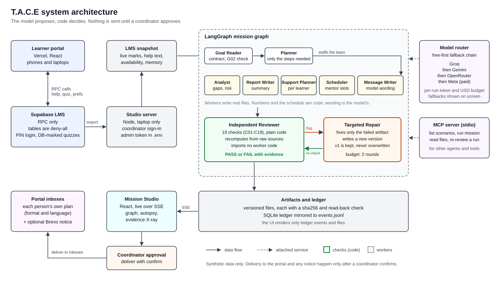

# Architecture diagram

Source: [`docs/media/architecture.svg`](../media/architecture.svg), hand-written SVG with a white background and system fonts, so it reads on GitHub in light and dark themes. A second diagram, [`self-correction.svg`](../media/self-correction.svg), shows the review, repair and re-check loop.

## Reading the diagram

| Block | What it is | Where in the code |
|---|---|---|
| Learner portal | React app on Vercel; phones and laptops. Calls named RPC functions only. | `apps/lms` |
| Supabase LMS | Postgres behind RPC functions; tables are deny-all; PIN login; quizzes marked in the database. | contract in `apps/lms/LMS-SPEC.md` |
| Studio server | Node server on the coordinator's laptop. Coordinator sign-in; holds the admin token. | `web/server.mjs`, `web/api/`, `engine/lms.mjs` |
| LMS snapshot | Live marks, help requests, availability and memory exported into the engine's normal sources. | `domains/education/lms-snapshot.mjs` |
| Mission graph | LangGraph state graph: Goal Reader, Planner, workers, independent Reviewer, Repair. | `engine/graph.mjs`, `engine/run.mjs`, `agents/`, `domains/education/` |
| Independent Reviewer | 19 plain-code checks (C01 to C19); imports no worker code; recomputes from raw sources. | `domains/education/reviewer.mjs` |
| Targeted Repair | Fixes only the failed artifact and writes a new version; budget of 2 rounds. | `domains/education/repair.mjs`, `REPAIR_BUDGET` in `engine/contracts.mjs` |
| Artifacts and ledger | Versioned files with sha256 and read-back; SQLite ledger mirrored to `events.jsonl`. | `engine/artifacts.mjs`, `engine/ledger.mjs` |
| Mission Studio | React UI that renders only ledger events (SSE) and files. | `apps/studio` |
| Coordinator approval | Delivery runs only on `POST /api/runs/:id/deliver` with `confirm: true`. | `web/server.mjs` |
| Portal inboxes and notice | Plans written to each person's inbox; optional Brevo email or SMS notice to opted-in people. | `engine/lms.mjs`, `engine/notify.mjs`, `docs/NOTIFICATIONS.md` |
| Model router | Free-first provider chain with fallbacks and a per-run budget. | `engine/providers.mjs`, `docs/MODEL-PROVIDERS.md` |
| MCP server | Exposes list, run, read and re-review as MCP tools over stdio. | `mcp/server.mjs` |

## Not drawn

The diagram shows the running system. The gate documents (G01 to G12) and the AG-UI, CopilotKit and OpenDots evaluations are design or evaluation material and are not part of this picture. See `docs/architecture/COMPLETE-SYSTEM-BLUEPRINT.md`.
