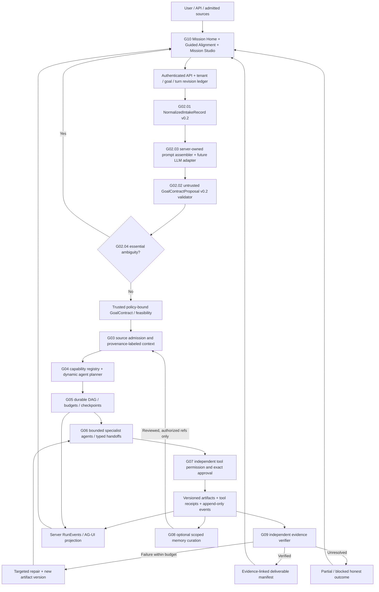

# T.A.C.E — complete system architecture, end-to-end execution and agents

**Updated:** 2026-11-13. **State:** REFERENCE DESIGN and implementation handoff, **not a deployed universal engine**. G01/G02.01/G02.02 design is accepted; G02.03 ADR-0007 remains proposed; PR #8 is unmerged. Read [handover](../handover/START-HERE.md) and [research map](../research/REFERENCE-MAP.md) before coding.

## 1. Mission and differentiators

T.A.C.E is a **domain-neutral, API-first goal-to-verified-execution engine**. A user states an outcome; the system clarifies material ambiguity, admits authorized evidence, discovers actual skills/tools, assembles proportional specialists, executes a durable task graph, verifies external results and files independently, repairs permitted failures and delivers **evidence-backed outcomes**.

The **first demonstration** is an *Autonomous Education Recovery Colleague* for an adult educator working with **synthetic data**: 36 fictional adult trainees and three fictional mentors. T.A.C.E must remain universal; do not hardcode that domain, those numbers or static success traces in its core.

Our product signatures are **Goal-to-Graph**, **Dynamic Mission Staffing**, **Mission Evidence X-Ray**, **Autonomous Failure Autopsy**, **Guided Alignment** and **Verified Deliverables**. These must become real runtime behaviors rather than illustrations. Do not integrate/reuse KAIRO.

### Non-negotiable architectural rules

1. The **server-owned event and artifact ledger** is authoritative. Model/chat/UI strings cannot create verified facts.
2. The model **proposes**, while deterministic validators, authenticated principal/tenant, capability registry, policy and exact approvals **decide**.
3. A requested Microsoft/Google/LMS tool is **not connected** simply because the user names it.
4. Every task has explicit inputs, outputs, source versions, effect bounds, acceptance checks, cost/time budget and typed handoffs.
5. Only real, independently rechecked artifacts/effects receive VERIFIED status; missing evidence yields PARTIAL/BLOCKED/UNKNOWN.
6. Consequential sends, shared writes, destructive operations and sensitive decisions require independent authorization and when necessary human review; draft != send.
7. EdTech data are synthetic for the first demo; no real learner records or unsupported bilingual fluency claims.
8. Agents are proportional to complexity; no fake swarms, no static choreographed repair loop.
9. A future UI is a **read-only projection of authoritative events** plus requests for server validation; never a permission engine.
10. Changes to accepted design baselines require a superseding ADR and user approval.

## 2. End-to-end architecture diagram

**All boxes after the existing G02 prototypes are architectural targets**, not claims of implemented services. Start with one reproducible backend and clear trust boundaries; microservices are not required.

## 3. System planes and ownership

| Plane | Owns | Explicitly cannot do |
|---|---|---|
| Experience (G10) | Goal UX, clarification cards, mission graph, agent roster, evidence, approval presentation, reports, accessibility | Grant permissions, report fabricated success or read provider secrets |
| Identity/control (G01/G02/G04/G07) | Server principal/tenant, goal revision, proposal validation, feasibility, tool/effect policy | Treat user/model source text as higher-trust identity |
| Context (G03/G08) | Source ownership, safe parsing, citation/provenance, scoped retrieval and optional memory | Elevate retrieved text/skills to platform instructions |
| Orchestration (G05/G06) | Task DAG, dependencies, budgets, retries, checkpoints, specialist work and handoffs | Bypass policy or mark work verified on narration alone |
| Effects (G07) | Tool versions, per-action scope, exact approvals, idempotency, provider receipts and read-back | Trust MCP readOnlyHint or UI clicks as authorization |
| Assurance (G09/G11) | Independent recomputation, artifact checks, repair decisions, evaluation/measurement | Rubber-stamp the same model or invent impact metrics |

## 4. Full lifecycle and contracts, numbered

### 0. Authentication and admission (G01/G07 — real service pending)

The gateway accepts a goal, optional source handles and constraints; **the server**, not prompt or client, binds actorRef, tenantRef, roles/scopes, goalId, turnId, parent, revision, idempotency key and rate/size limits. Current code uses trusted *fixtures*, which are not authentication.

**Safe fallback:** reject private operations without authenticated scope; permit a clearly labeled local synthetic draft only when permitted.

### 1. Intake normalization (G02.01 — design accepted; code/test present)

`normalizeGoalTurn()` preserves exact decoded user text and produces NFC/LF interpretation, provenance, bounded opaque source references, time/locale/budget hints and Unicode/ambiguity flags. `projectForInterpreter()` exposes only an allowlisted model view without internal actor/tenant IDs or actual source handles; `assessTurnRevision()` compares expected lineage.

**Limits:** comparison is not a real atomic event ledger; the view can still contain personal data in the user's text and is **not anonymized**.

### 2. Trusted prompt assembly (G02.03 — proposed; bounded code/test present)

The platform chooses actual `system`, `developer` and `user` message roles; untrusted goal/document/memory/skill strings cannot create new privileged roles. A version-pinned template references G02.02 v0.2 output schema and budget constraints. Retrieved snippets are future, separately admitted *data*. Prompt bodies/chain-of-thought are not logged by default.

`assemblePrompt()` on main builds an envelope **without calling a model**; PR #8 adds intake hardening. No semantic injection resistance, server auth, provider adapter or production privacy has been proven.

### 3. Typed goal proposal (G02.02 — design accepted; code/test present)

`validateGoalProposal(candidate, intake)` validates an **untrusted** `g02-goal-proposal-v0.2` containing:
- intent modes CREATE/ANALYZE/TRANSFORM/COORDINATE/COMMUNICATE/UNKNOWN;
- 1–8 deliverables, 1–12 candidate subgoals, unique IDs and an acyclic dependency graph;
- per-subgoal source slots, capability kinds and *claimed* effect kinds;
- 1–16 acceptance criteria with required expected-evidence descriptions;
- bounded uncertainties, correction relation and normalized intake binding.

It returns **PROPOSAL_VALID**, **NEEDS_CLARIFICATION**, **POLICY_REVIEW_REQUIRED** or **REJECTED_PROPOSAL**. These mean structure/status only: `policyAuthority=NONE`, semantics unverified, checks not run. Never skip downstream actual tool/effect checks.

### 4. Clarification (G02.04 — requirement captured; policy NOT implemented)

The policy chooses between **Adaptive** (ask only material questions), **Guided Alignment** (optional short progressive multi-choice with Other/Not sure/Back/Review) and **Quick Start** (reversible assumptions only).

Question triggers when answers change intended output, source access, time/cost, recipients, effect class, acceptance criteria or serious irreversible outcome. Answers are bound to current goal/turn/revision and **atomically create a new authenticated turn**; invalidate/recheck prior plans and approvals. Never let Quick Start disable essential security/consent gates.

**Prototype:** `tools/integrations/agui/tace-clarification-events.mjs` generates display-only AG-UI-shaped events. Draft PR #8 contains a working *offline synthetic browser wizard* and a candidate JSON preview; it does not commit authenticated answers or run a model.

### 5. Context engineering (G03 — future)

Every upload/public URL/connected item must pass:
1. authenticated owner/tenant and permitted purpose;
2. size/MIME/extension/quarantine parser policy, source registry and network-egress/SSRF checks;
3. immutable source ID, version/hash, parser version, classification, retention and citation offsets;
4. source reliability, conflict/staleness checks and task-specific retrieval;
5. bounded ContextBundle with explicit source slots and untrusted-data labels;
6. proper lossless/error-aware text extraction and data minimization.

No arbitrary file content becomes a system prompt. Start with **synthetic CSV and JSON only**; office/PDF/Docling/RAG/vector retrieval are later candidates.

### 6. Capability and dynamic skill/agent planning (G04 — future)

Registry must describe `operationId`, adapter/version, input/output schema, connector state (`CONNECTED`, `AVAILABLE_NOT_CONNECTED`, `SIMULATED_FIXTURE`, `UNSUPPORTED`), tenant scopes, effect classification, supported formats, cost/latency/quota, replay/idempotency, approval needs and evidence/read-back mechanism.

**Dynamic staffing:** no LLM for pure deterministic conversions, single worker for simple drafts, specialist DAG when true dependencies or different tools/skills justify it. A model can request capabilities but cannot invent their availability.

Skills are **reviewed, pinned, tested** manifests. `AGENTS.md`, `RULES.md`, `SKILL.md` and `MEMORY.md` are not model/platform authority. No auto-installing arbitrary skills, no automatic credential acquisition.

### 7. Durable graph and task execution (G05 — future)

Compile a **feasible** graph after policy/capability resolution. Task has typed input artifact IDs, dependencies, handler/version, read/write sets, risk, tool scopes, acceptance criteria and bounded retries/time/cost. A run progresses through server-validated transitions: NEW → CLARIFYING/READY → PLANNED → RUNNING → REVIEWING/REPAIRING → VERIFIED or PARTIAL/BLOCKED/FAILED/CANCELLED.

Rules: acyclic edges; only READY task starts; task retries idempotent; conflicting file writes serialized; snapshots/event sequences atomic; timeout/cancel respected; repair rounds capped; replay after crash does not repeat already acknowledged external sends. The DAG owns state, not model narration.

**Minimum backend choice open:** Node/TypeScript with SQLite for fastest reuse of present `.mjs`, or Python FastAPI/Pydantic/LangGraph if it demonstrably improves delivery. Do not install a large framework without proving the benefit.

### 8. Specialist communication (G06 — future)

Logical roles:
- Planner/controller: decomposes feasible goal, selects next task, handles replanning;
- Evidence Analyst: parses admitted assessments, computes scores/coverage and flags missing data;
- Intervention Specialist: maps verified gaps to support interventions/accessibility;
- Schedule Planner: allocates mentors and checks time, overlap, capacity and conflicts;
- Artifact/Comms Producer: writes persisted reports, plans, proposed schedules and **unsent** messages;
- Independent Reviewer: reopens artifacts and recomputes checks separately from producers;
- Repair Worker: edits failed artifacts only then returns to independent reviewer;
- Memory curator (later): optional reviewed retention of approved facts only.

Typed handoffs include from/to task, run, input hashes, output artifact refs, source evidence, uncertainties, status, timestamps and trace IDs. **An agent is real only when it performs real work and produces a reproducible handoff.** 5–8 roles are a logical library, not eight always-running assistants.

### 9. Tool/approval boundary (G07 — future P0)

Server independently classifies effects as READ_ONLY, LOCAL_ARTIFACT, SHARED_WRITE, EXTERNAL_SEND, DESTRUCTIVE or UNKNOWN based on **actual adapter/operation**, not model claim or MCP `readOnlyHint`.

Execution gate must verify:
- signed/attested current principal, tenant, connection and resource owner;
- operation schema, arguments, actual side effects, privacy tier and quotas;
- cost, retries, timeout, idempotency key and compensation;
- when consequential, immutable proposed action digest, exact target/recipient/body/args, actor-approved scope, current goal revision, expiry and one-time consumption;
- provider receipt and independent read-back, including no duplicate effects.

Approval dialog is a **presentation**, not security. If anything changes, invalidate approval and re-review. Demo sends **nothing** externally; no official grading or real learner data.

### 10. Independent validation and targeted repair (G09 — future P0)

A verifier must open real files, not evaluate a model summary. Checks:
- source rows/counts, skill thresholds and aggregate recomputation independently;
- schedule overlap/capacity/timezone and mentor availability;
- evidence citations resolve to admitted source ID/version/row;
- artifact exists, parses, reopens and matches the accepted output schema;
- no messages sent when only drafts authorized;
- language/accessibility reviewed honestly when not tested.

On real failed check: record `VERIFICATION_FAILED` with actual expected/observed values and source/criterion; create bounded targeted repair task, write new version, independently rerun checks; preserve failed/repaired versions and diff. This produces **Failure Autopsy**.

A reproducible synthetic fault injection is acceptable only if it actually corrupts an intermediate artifact and triggers true detection/repair. It cannot be a pre-scripted red/green UI. When repair cannot proceed safely, report BLOCKED/PARTIAL.

### 11. Memory/skills (G08 — future)

Distinguish ephemeral run state, episodic events, curated semantic knowledge and approved procedural skills. Scope by tenant/user/project, version, purpose, lawful basis/consent, source/evidence, TTL, encryption, deletion/correction and conflict handling. Do **not** store unverified model guesses as facts or use another tenant's history. Honcho, Obsidian-like notes, Mem0, Letta, Graphiti/Zep are research candidates, not configured infrastructure.

### 12. Mission Console, benchmark and final delivery (G10–G12 — future)

Mission Home, Guided Alignment, Mission Studio/DAG, Agent Activity, Evidence X-Ray, Failure Autopsy, Artifacts, Approvals, Connections, Memory and Audit. Events projected through SSE/WS or an AG-UI adapter. UI is not the ledger. Progressive disclosure, keyboard/mobile/screen reader and reduced-motion are required. See [UI blueprint](MISSION-CONSOLE-UX-DESIGN-SYSTEM.md).

Evaluation compares **manual**, **single-model** and **T.A.C.E** tasks on same synthetic fixture. Track verified correctness, completion time (human and compute separated), cost, unnecessary clarifications, wrong-task rate, privacy/security failures, real repair success and user utility. Never claim measured time savings/110 marks without real evidence.

## 5. Runtime entities and storage (proposed)

| Entity | Core fields / invariants |
|---|---|
| Principal / Tenant | Server-attested actor/roles/scopes, tenant_id, connection registry, revocation |
| Goal / Turn | goalId, current revision, parentTurnId, raw/normalized text hash, constraints, intent |
| Proposal / Contract | version, source slots, accepted outputs, policy binding, criteria, immutable plan digest |
| Clarification | questionId/version, affected field, options, other/skip semantics, expiry, answered-by, consumed |
| Source | owner, sourceId/version/hash, parser/admission, provenance/citations and retention |
| Capability | operation ID/version, effect, connection status, scopes, quotas, verifier |
| Run / TaskNode | runId, taskId, DAG, dependency status, attempts, budgets, reads/writes |
| AgentHandoff | scoped input/output refs, source citations, uncertainty, producer identity and event |
| Event | monotonic per-run sequence, type, timestamp, actor (server), payload ref, prior event hash optional |
| Approval | immutable action hash, approver/scope/tenant/expiry/consumed status |
| Receipt | actual provider/local operation, result ID/version, artifact hash, read-back proof |
| EvidenceCheck | check ID/version, actual observed/expected, PASS/FAIL/UNKNOWN, source refs, verifier |
| Artifact | ID/version, MIME, path/storage ref, digest, produced_by, verified_by, retention |
| MemoryRecord | type, tenant/scope, source, verification, consent, TTL, correction/deletion controls |

**Deployment:** initially one backend + SQLite with append-only ledger and versioned local artifact directory, frontend static Vite optional. Later PostgreSQL/object storage, workers/queues, sandboxed tools, telemetry and memory only when required. No credentials or private datasets in Git.

## 6. First real education mission — reference outputs and data

Input fixtures:
- `trainees.csv`: 36 **fictional adults**, stable IDs, synthetic assessment dimension/skill scores;
- `assessment-skills.csv` with threshold and topic mappings;
- `mentors.csv` and `availability.csv` for 3 fictional mentors and capacity/time windows;
- user goal + explicit do-not-send/draft-only policy; optional language/accessibility needs.

Deliverables with actual file outputs and source evidence:
1. gap-analysis.csv (per-trainee skill gaps, source row ID and approved rule);
2. performance-summary.md/html (counts, distribution, missing data, assumptions);
3. improvement-plan.md/json (recommended interventions justified by actual source rows);
4. mentor-schedule.csv (feasible allocation; no overlap/capacity violations);
5. unsent-message-drafts.md (text only; zero send receipts);
6. evidence-checks.json, repair-history.json, artifacts-manifest.json and events.jsonl.

Required real loop:
- ingest/validate synthetic files → build goal-specific DAG → write artifacts → inject one genuine controlled **intermediate** conflict or calculation defect (documented fixture) → Reviewer catches it with independently computed rule → Repair changes affected output version → Reviewer reopens/rechecks → final manifest only verifies passed criteria;
- change mentor availability to force a new plan; test missing source/unsupported request safely halts;
- compare against manual and ordinary assistant baseline only after actually measuring.

Do not claim that current repository already implements this path. [Hackathon playbook](../hackathon/COLLEAGUE-ZERO-110-POINT-EXECUTION-PLAYBOOK.md) gives rubric-specific proof, and [execution backlog](EXECUTION-BACKLOG-AND-ACCEPTANCE-TESTS.md) gives coding order.

## 7. Gate status truth table

| Gate | Purpose | Observed design/runtime status |
|---|---|---|
| G01 | Universal goal boundary and EdTech proof | DESIGN_COMPLETE; small boundary tests |
| G02.01 | Normalized intake v0.2 | DESIGN_ACCEPTED; deterministic code/test |
| G02.02 | Strict GoalContractProposal v0.2 | DESIGN_ACCEPTED; deterministic code/test |
| G02.03 | Trusted prompt assembly | ADR PROPOSED; bounded prototype, PR #8 hardening unmerged |
| G02.04–G02.15 | Clarification, success criteria, risk, capabilities, proportionality, confidence, repair, language, adversarial, model eval, API/exit | Mostly planned / not approved |
| G03 | Source and context | FUTURE |
| G04 | Capabilities, skills, planner | FUTURE |
| G05 | Durable graph runtime | FUTURE |
| G06 | Agent handoffs/swarm | FUTURE |
| G07 | Identity, tools, approvals, receipts | FUTURE, P0 |
| G08 | Governed memory | FUTURE |
| G09 | Independent review and repair | FUTURE, P0 |
| G10 | Production Mission Console | FUTURE; offline UI proof in draft PR #8 |
| G11 | Evaluation/privacy | FUTURE |
| G12 | End-to-end integrated outcome | FUTURE, P0 |

**Never confuse DESIGN_ACCEPTED, IMPLEMENTED, UNIT_VERIFIED, INTEGRATION_VERIFIED, PRODUCTION_VERIFIED.** Green unit CI does not equal completed mission or impact. Accepted G02 decisions need explicit migration if changing schema.

## 8. Development and technical choices

**Candidate minimal implementation:** React/TypeScript/Vite, shadcn/ui/Radix, React Flow, AG-UI-compatible adapter; backend Node/TypeScript (shortest bridge from existing `.mjs`) **or** Python FastAPI/Pydantic with LangGraph if evidence justifies it; SQLite for bounded local event ledger; synthetic CSV/JSON fixtures; deterministic independent reviewer. Stack choice remains **proposed**.

**Candidate expansion:** CopilotKit/OpenDots/OpenBot, MCP/A2A connectors, TanStack Table, Tiptap, Motion, Docling, Langfuse/Phoenix, Qdrant/pgvector, LangGraph/Temporal, Honcho/Mem0/Graphiti. Evaluate licenses, costs and real integration need before adoption; CopilotKit Intelligence may require separately licensed/hosted runtime.

**Test evidence needed:** exact GitHub SHA + command + CI run, source fixture digests, output manifests/hashes, check receipts and independently rerunnable repair evidence. Keep a complete failure log; no background execution promises.

See [contracts and APIs](CONTRACTS-STATE-MACHINE-AND-APIS.md), [security and memory](SECURITY-MEMORY-AND-TOOL-BOUNDARIES.md), [Mission Console UI](MISSION-CONSOLE-UX-DESIGN-SYSTEM.md), [execution and test backlog](EXECUTION-BACKLOG-AND-ACCEPTANCE-TESTS.md).
