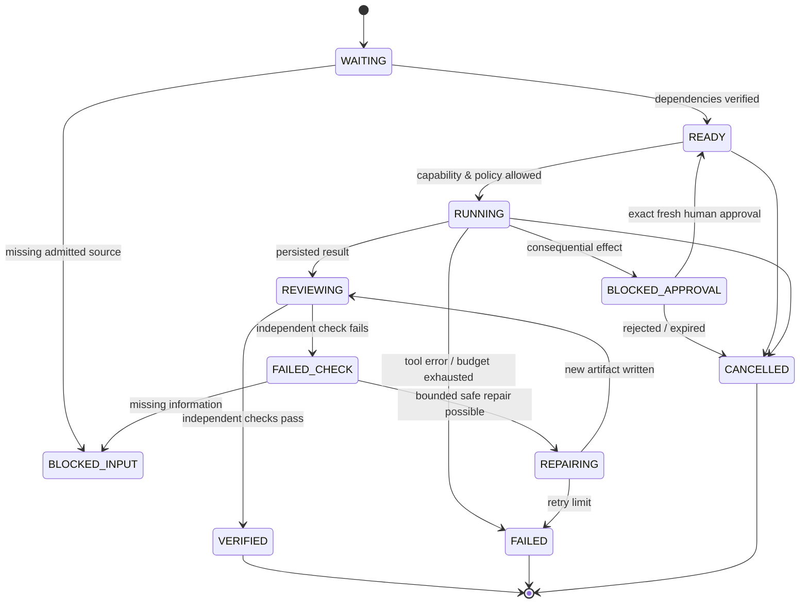
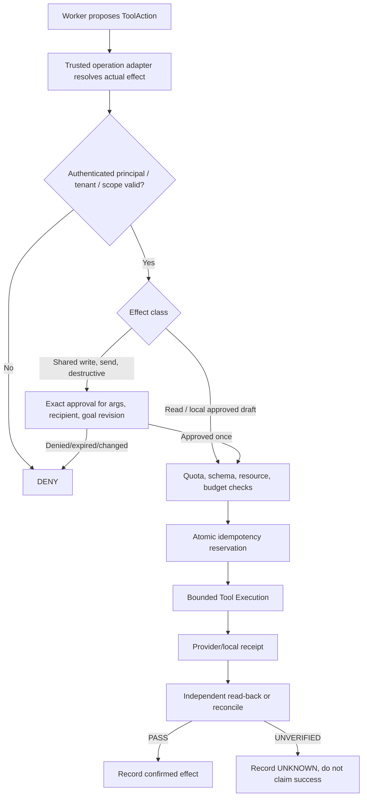

# T.A.C.E — technical contracts, API, event state machine and execution receipts

**Date:** 2026-11-13. **Status:** PROPOSED integration specification, **NOT an implemented HTTP API or ledger**. It harmonizes [accepted G02.01/02 schemas](../gates/GATE-02-02-GOAL-SCHEMA-AND-DECOMPOSITION.md), [older draft contracts](../02-contracts-and-protocols.md) and [G01 secure tool policies](../gates/GATE-01-SECURITY-THREAT-MODEL.md). Do **not** silently change accepted `g02-intake-v0.2` and `g02-goal-proposal-v0.2`; create explicit migration/ADR first.

## 1. Hard boundaries and ordering

**Authenticated request** → G02.01 `NormalizedIntakeRecord` → G02.03 prompt package → model output **proposal** → G02.02 deterministic validation → G02.04 essential clarifications → **server-bound authorized GoalContract** → G03 source admission → G04 feasible DAG → G05/G06 work → G07 tools and approvals → G09 independent evidence → G10 delivery.

The executor must never call `validateGoalProposal` and mistake `PROPOSAL_VALID` for authorization. Likewise `assemblePrompt` returning `ASSEMBLED` means **messages ready, not model inference completed**. AG-UI events, React state, fake agent logs, MCP metadata and memory cannot issue tool permissions.

**Contract design principle:** every record includes schema version, stable IDs, trusted scope, immutable source/plan/action hashes where appropriate, explicit status, error codes and links to evidence/receipts. Use static runtime schema validation on every trust boundary. Existing local JS modules can serve as initial contract validators; production requires a reviewed full schema engine and release pins.

## 2. Existing G02 contract — exact reused entry points

Main code:
- `tools/gate02/normalize-turn.mjs`: `normalizeGoalTurn(request, trustedFixture)`, `projectForInterpreter(record)`, `assessTurnRevision(prev,next)`.
- `tools/gate02/goal-proposal.schema.json`: exact untrusted model candidate shape, **version `g02-goal-proposal-v0.2`**.
- `tools/gate02/goal-proposal.mjs`: `validateGoalProposal(candidate,intake)`, `assessGoalProposalRevision(...)`.
- `tools/gate02/prompt-assembly.mjs`: `assemblePrompt(intake,opts)`; role envelope **version `g02-prompt-assembly-v0.1`**.
- `tools/integrations/agui/tace-clarification-events.mjs`: `makeClarificationEvents(...)`, `previewClarificationAnswer(...)`; **display/preview only**.

G02.02 current validated candidate:
```
{
  schemaVersion, intent:{summary,modes}, relationToPrior,
  deliverables:[{id,description,formatHint}],
  subgoals:[{id,outcome,dependsOn,deliverableIds,sourceSlots,capabilityKinds,effectKinds}],
  sourceSlots:[integer], capabilityNeeds:[{kind,reason}],
  effectClaims:[{kind,description}],
  acceptanceCriteria:[{id,deliverableId,check,method,evidenceExpectation}],
  uncertainties:[{code,question,blocking}]
}
```
This is **model-proposed**, limited to bounded arrays/strings; fields such as `approved`, `verified`, `actorRef`, `tenantRef`, actual source handles and tool receipts are **forbidden in a candidate**. The validator's `binding` is derived from intake fixture, with an internal SHA-256 correlation hash **not a signature**.

## 3. Proposed server data types (illustrative TypeScript, NOT existing source)

```ts
type Id = string;
type Effect = "READ_ONLY" | "LOCAL_ARTIFACT" | "SHARED_WRITE"
  | "EXTERNAL_SEND" | "DESTRUCTIVE" | "UNKNOWN";
type ProofStatus = "PASS" | "FAIL" | "UNKNOWN" | "NOT_RUN";
type ProposalStatus =
  | "PROPOSAL_VALID" | "NEEDS_CLARIFICATION"
  | "POLICY_REVIEW_REQUIRED" | "REJECTED_PROPOSAL";

interface PrincipalContext { // generated by gateway only
  principalId: Id; tenantId: Id; roleIds: string[];
  scopes: string[]; attestedAt: string; sessionId: Id;
  authVersion: string; // never forwarded as client authority
}
interface NormalizedTurnBinding {
  goalId: Id; turnId: Id; parentTurnId: Id | null;
  revision: number; intakeDigest: string;
  tenantId: Id; principalId: Id; // server internal only
}
interface SourceRef {
  id: Id; version: Id; kind: "upload" | "connector" | "public";
  ownerTenantId: Id; contentDigest: string;
  mime: string; sensitivity: "synthetic" | "public" | "internal" | "personal" | "restricted";
  parserVersion?: string; admission: "ADMITTED" | "QUARANTINED" | "DENIED";
  citationIndex?: Id; lawfulPurpose?: string;
}
interface CapabilityDescriptor {
  id: Id; version: string; operation: string;
  status: "CONNECTED" | "AVAILABLE_NOT_CONNECTED" | "SIMULATED_FIXTURE" | "UNSUPPORTED";
  inputSchemaDigest: string; outputSchemaDigest: string;
  effects: Effect[]; permittedTenantIds?: Id[];
  connectorScopes: string[]; resources: string[];
  maxAttempts: number; timeoutMs: number; costLimit?: number;
  supportsIdempotency: boolean; receiptVerifier: string | null;
}
interface AcceptanceCheck {
  id: Id; subjectArtifactId: Id;
  checkType: "SCHEMA" | "SOURCE_RECOMPUTE" | "SCHEDULE_CONFLICT"
    | "ARTIFACT_REOPEN" | "RECEIPT_READBACK" | "HUMAN_REVIEW";
  expected: unknown; observed?: unknown; verifierVersion: string;
  sourceRefs: {sourceId: Id; version: Id; locator?: string}[];
  status: ProofStatus; evidenceRef?: Id; checkedAt?: string;
}
interface ServerBoundGoalContract {
  schemaVersion: "tace-goal-contract-v0.1"; // PROPOSED, not implemented
  goalId: Id; currentTurnId: Id; revision: number; tenantId: Id;
  actorId: Id; interpretationProposalDigest: string;
  desiredOutputs: {id: Id; description: string; format: string | null}[];
  sourceBindings: SourceRef[]; constraints: Record<string, unknown>;
  acceptedAssumptions: string[]; acceptanceChecks: AcceptanceCheck[];
  authorizedEffectCeilings: Effect[]; policyDecisionId: Id;
  status: "ADMITTED" | "NEEDS_CLARIFICATION" | "INFEASIBLE" | "READY";
}
interface TaskNode {
  taskId: Id; runId: Id; goalId: Id; planVersion: number;
  capabilityId: Id; workerId: Id | null;
  dependsOn: Id[]; inputs: {artifactId: Id; version: Id}[];
  writes: Id[]; acceptanceCheckIds: Id[]; expectedEffect: Effect;
  maxAttempts: number; maxRepairRounds: number;
  deadlineAt?: string; budgetCents?: number;
  status: TaskState; // state machine below
}
interface AgentHandoff {
  version: "tace-handoff-v0.1";
  runId: Id; fromTaskId: Id; toTaskId: Id | null;
  producedArtifacts: {artifactId: Id; version: Id; digest: string}[];
  citedEvidence: {sourceId: Id; sourceVersion: Id; locator?: string}[];
  uncertainties: string[]; proposedNext: Id[];
  eventId: Id; emittedAt: string;
}
interface ActionProposal { // NEVER a tool execution grant
  actionId: Id; runId: Id; taskId: Id; operationId: Id;
  principalId: Id; tenantId: Id; connectionId: Id | null;
  resourceId: Id | null; args: unknown; expectedEffect: Effect;
  actionFingerprint: string; currentGoalRevision: number;
  policyDecisionId: Id; expiryAt: string; idempotencyKey: string;
}
interface ApprovalDecision {
  id: Id; actionId: Id; approved: boolean;
  actionFingerprint: string; approverPrincipalId: Id;
  tenantId: Id; goalRevision: number;
  decisionAt: string; expiresAt: string; consumedAt?: string;
}
interface ToolReceipt {
  version: "tace-tool-receipt-v0.1"; actionId: Id; operationId: Id;
  attemptedAt: string; finishedAt?: string;
  status: "ATTEMPTED" | "CONFIRMED" | "FAILED" | "UNKNOWN";
  providerRequestId?: string; providerResourceId?: string;
  beforeVersion?: string; afterVersion?: string;
  artifactDigest?: string; readbackCheckId?: Id; errorCode?: string;
}
interface ArtifactManifestEntry {
  artifactId: Id; version: Id; runId: Id; producerTaskId: Id;
  kind: string; mime: string; safeStorageRef: string; digest: string;
  sourceRefs: {sourceId: Id; version: Id; locator?: string}[];
  criteria: AcceptanceCheck[]; verifiedAt?: string;
}
```

**Security:** These snippets are target interfaces. The client may see minimized public projections, but **never** the whole PrincipalContext or secrets. The only authoritative actor binding comes from the actual authenticated gateway, never a JSON property supplied by client/model. Equality checks and hashes alone are not authenticated signed history.

## 4. Proposed task state and run state machines



**Run states (proposed):** `NEW`, `NEEDS_CLARIFICATION`, `PLANNING`, `READY`, `RUNNING`, `WAITING_APPROVAL`, `REPAIRING`, `VERIFYING`, terminal `VERIFIED | PARTIAL | BLOCKED | FAILED | CANCELLED`. `VERIFIED` is legal only when all **required** accepted criteria passed with actual evidence and no unresolved effects. `PARTIAL` lists exact incomplete criteria. Changes to a goal or accepted source/recipient create new revision and invalidate dependent plans/approvals.

**Invariant checks:** no task executes if dependency incomplete, permission absent or plan revision stale; simultaneous writers to same artifact coordinate by version/lock; no `CHECK_PASSED` emitted before actual verifier observation; retries never blindly repeat remote sends.

## 5. Proposed HTTP API and real-time protocol — NOT implemented

Prefix `/v1` is illustrative, not a contract the current repo exposes.

| Method/path | Request/response | Required safety |
|---|---|---|
| `POST /v1/goals` | `{goal,sourceHandles?,constraints?}` → goalId, turnId, status, proposal/clarification | Gateway attests actor/tenant, idempotency key, bytes/locale, no client identity |
| `GET /v1/goals/:goalId` | Current sanitized goal state and current revision | Tenant-scoped read; omit hidden policy/secrets |
| `POST /v1/goals/:goalId/turns` | User correction, `expectedRevision`, parent, context → new turn | Atomic compare-and-swap, stale/replay denial, approval invalidation |
| `POST /v1/goals/:goalId/clarifications/:questionId/answer` | Selected stable option or Other text, `expectedRevision`, question version | Idempotent consume, answer validation, expiry, new turn and recompilation |
| `POST /v1/runs` | Bound accepted contract version → runId/state | Check feasibility, current policy, budgets, source admission |
| `GET /v1/runs/:runId` | Sanitized task/status snapshot | Tenant-scoped read, no fabricated statuses |
| `GET /v1/runs/:runId/events?cursor=N` | Ordered server `RunEvent` stream via SSE/WS or AG-UI projection | Authenticated, monotonic cursor, resume, retention |
| `GET /v1/runs/:runId/artifacts` | Manifest entries with verified criteria and safe download URLs | ACL, signed expiring storage URL, approved output scope |
| `GET /v1/runs/:runId/artifacts/:artifactId` | Download/open exact artifact version | Tenant ownership and data classification |
| `POST /v1/runs/:runId/approvals/:actionId/decision` | Approved/rejected, bound action fingerprint/expiry | Re-auth human, exact args/recipient, tenant scope, one-time consume |
| `POST /v1/runs/:runId/cancel` | Cancel token + expected version → stopping/stopped | Safe cancellation and external action reconciliation |
| `GET /v1/capabilities` | Actual connected/simulated/unsupported operations | Tenant-scoped; no invented apps/privileges |
| `POST /v1/sources` | Upload metadata and content admission → quarantine/source ref | Size/parser/content/ownership verification; no arbitrary SSRF |

### Common HTTP error contracts (proposed)

`{error:{code, message, retryable, correlationId, expectedRevision?, currentRevision?}}`. Stable codes: `INVALID_SCHEMA`, `AUTH_REQUIRED`, `TENANT_FORBIDDEN`, `SOURCE_NOT_ADMITTED`, `CAPABILITY_UNAVAILABLE`, `NEEDS_CLARIFICATION`, `POLICY_REVIEW_REQUIRED`, `APPROVAL_STALE`, `APPROVAL_DENIED`, `IDEMPOTENCY_CONFLICT`, `REVISION_CONFLICT`, `TOOL_TIMEOUT`, `RECEIPT_UNVERIFIED`, `CHECK_FAILED`, `REPAIR_BUDGET_EXHAUSTED`, `PROVIDER_UNAVAILABLE`.

No raw secret, sensitive source content, internal prompt policy or stack trace in public errors.

## 6. Proposed event envelope and AG-UI mapping

Events originate from the **server ledger**. An AG-UI adapter maps a safe subset to frontend protocol. AG-UI `CUSTOM` event names are **T.A.C.E extensions**, not automatically standardized.

```json
{
  "schemaVersion": "tace-run-event-v0.1",
  "eventId": "event-demo-00017",
  "runId": "run-synthetic-1",
  "seq": 17,
  "occurredAt": "2026-11-13T09:20:00Z",
  "type": "VERIFICATION_FAILED",
  "taskId": "schedule",
  "goalRevision": 2,
  "actor": "server:independent-reviewer",
  "payload": {
    "criterionId": "mentor_overlap",
    "artifactId": "mentor-schedule",
    "artifactVersion": "v1",
    "checkRef": "check-001",
    "status": "FAIL"
  }
}
```

**Server event taxonomy (proposed):**
- `GOAL_RECEIVED`, `INTAKE_NORMALIZED`, `PROPOSAL_VALIDATED`, `CLARIFICATION_REQUESTED`, `CLARIFICATION_ANSWERED`, `CONTRACT_BOUND`;
- `SOURCE_ADMITTED`, `SOURCE_DENIED`, `CAPABILITY_MATCHED`, `PLAN_CREATED`, `PLAN_REVISED`, `TASK_READY`, `TASK_STARTED`, `AGENT_HANDOFF`;
- `TOOL_ACTION_PROPOSED`, `APPROVAL_REQUESTED`, `APPROVAL_DENIED`, `APPROVAL_GRANTED`, `TOOL_ACTION_ATTEMPTED`, `TOOL_RECEIPT_RECONCILED`;
- `ARTIFACT_VERSION_WRITTEN`, `VERIFICATION_STARTED`, `VERIFICATION_FAILED`, `REPAIR_SCHEDULED`, `ARTIFACT_REPAIRED`, `VERIFICATION_PASSED`;
- `RUN_PARTIAL`, `RUN_BLOCKED`, `RUN_FAILED`, `RUN_CANCELLED`, `RUN_VERIFIED`.

**AG-UI projection:**
- Standard protocol shapes for `RUN_STARTED`, `CUSTOM`, `RUN_FINISHED` with `interrupt` (when awaiting clarification), and standard messages/state as appropriate.
- T.A.C.E namespaced custom events like `tace.clarification.requested.v1`, `tace.task.changed.v1`, `tace.artifact.versioned.v1`, `tace.evidence.checked.v1`, `tace.repair.completed.v1` are **proposed app semantics**.
- Preserve monotonic `seq` and server event IDs inside a safe projection; clients reconnect with cursor and deduplicate.
- **Never** let a client-sent `CUSTOM`, `RUN_FINISHED` or UI badge authorize a tool, mark verification passed or change current goal revision.
- PR #8 tests official AG-UI 1.0 **envelope** schema on synthetic events, not a live CopilotKit service or auth.

## 7. Clarification question/answer contracts (G02.04 proposal)

```ts
interface ClarificationQuestion {
  questionId: Id; goalId: Id; issuedForTurnId: Id; expectedRevision: number;
  mode: "ADAPTIVE" | "GUIDED" | "QUICK";
  kind: "SINGLE_CHOICE" | "MULTI_CHOICE" | "SHORT_TEXT";
  prompt: string; reason: string; options?: {id: Id; label: string}[];
  otherAllowed: boolean; notSureAllowed: boolean; optional: boolean;
  affectedFields: string[]; blocking: boolean;
  issuedAt: string; expiresAt: string; consumedAt?: string;
}
interface ClarificationAnswer {
  questionId: Id; optionIds?: Id[]; otherText?: string | null;
  expectedRevision: number; idempotencyKey: string;
}
```

Reject stale/wrong-goal/wrong-tenant answers, extra authority fields, replay, expired option sets, contradictory corrections and unsanitized output rendering. A client-side answer *preview* is never persistence or an approval. Only safe low-risk drafts can proceed on labeled assumptions.

## 8. Tool/effect, exact approval and idempotency flow



**Approval fingerprint** must cover: operation ID/version, tenant, principal/connection, resource version, recipient/target, action arguments, goal/turn/plan revision, effect class and expiry. Changing any field invalidates prior approval. Use a stable canonical encoder plus a **server-keyed/DB-attested** binding where appropriate; SHA-256 by itself is not access control.

**Retries:** for remote non-idempotent effects prefer reconciliation/check provider request IDs before retry. Even if provider response times out, an operation may have succeeded; mark `UNKNOWN`, inspect read-back, do not double-send.

## 9. Verifier, repair and artifact proofs

A verified output needs a **stored file**, source provenance and a checker run. Proposed artifact/manifests:
```
runs/<runId>/
  input-manifest.json
  events.jsonl
  plan.v1.json
  artifacts/
    gap-analysis.v1.csv
    performance-report.v1.md
    improvement-plan.v1.json
    mentor-schedule.v1.csv
    mentor-schedule.v2.csv
    unsent-message-drafts.v1.md
  checks/
    schedule.v1.fail.json
    schedule.v2.pass.json
    assessment-recompute.pass.json
  repair-history.json
  final-manifest.json
```

- The reviewer **reopens** v1 and independently checks a real overlap/aggregation mismatch. Preserve v1.
- Repair creates v2 and a repair event that identifies exactly what changed.
- The reviewer independently reruns and writes a **new** PASS evidence record only if v2 truly passes.
- Final manifest includes only checks actually PASS and explicitly lists unresolved/unknown checks. No false claims for skipped grade, multilingual or human review.
- SHA digests establish byte identity, not semantic correctness. Reviewer independence comes from separate code/algorithm and source data—not solely calling the writer-model again.

## 10. Security / concurrency acceptance

Minimum negative tests before a live protected API:
- client-provided `actorRef`/tenant/role/approval rejected;
- duplicate JSON keys and prototype pollution fail at parser validation;
- stale revisions, parallel corrections, duplicate answers and expired question IDs denied atomically;
- source handles from another tenant or missing connector never read;
- prompt/document containing fake `SYSTEM` never escalates actual message role or policy;
- invalid/unbounded DAG, unexpected tool effect, mismatched action fingerprint and forged receipt denied;
- double-click approval, timeout after provider effect and retry cannot duplicate an external send;
- resumed run does not replay a verified task or erase the original failed artifact;
- cross-tenant events, artifacts and memory invisible in API and UI;
- no real learner data, secrets or raw prompts leaked into logs/snapshots by default.

## 11. Migration and implementation order

1. Keep accepted `g02-intake-v0.2` and `g02-goal-proposal-v0.2` exactly; pin tests.
2. Define **server-only** TypeScript/Pydantic runtime contracts in a new package; use adapters and explicit versions, not direct edits to accepted source.
3. Implement synthetic **local-only event store**, idempotent task state machine, source manifest and artifact persistence.
4. Implement deterministic checker and real targeted repair on saved synthetic files.
5. Add minimal API and streamed UI event projection; gradually attach client clarification/AG-UI and render real artifacts.
6. Only after security approval: authenticated connectors, scoped real effects, provider adapter, optional memory, production deployment.

**Do not infer permission to run or merge these steps unattended.** Each meaningful implementation/change needs concrete tests, review and the owner's authorization according to existing practice.
